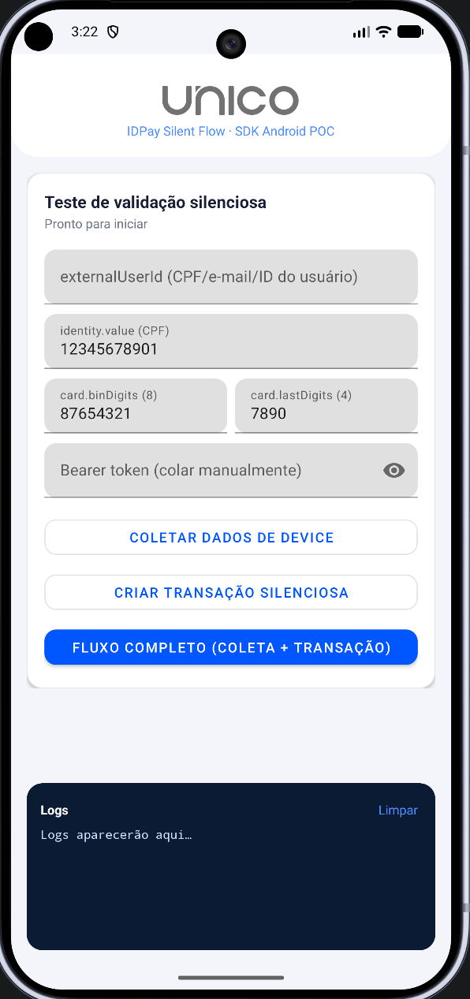

<p align="center">
  <a href="https://unico.io">
    
  </a>
</p>

<h1 align="center">IDPay Silent Flow — SDK Android POC</h1>

<div align="center">

### POC de teste ponta a ponta da validação silenciosa de transações via SDK Android + IDPay


</div>

---

## 🎯 O que esta POC faz

Este projeto testa o fluxo de **validação silenciosa de transações** em um app nativo:

1. A SDK Android coleta os dados de device em silêncio — **sem câmera** e sem nenhuma captura do usuário:
   - `UnicoSDK.initializeSDK` roda **no launch do app** (`SilentFlowApplication.onCreate`), fora do caminho crítico: a SDK se autentica e aquece a coleta antes de o usuário chegar ao fluxo;
   - `startSilentValidation(PrepareInfo(externalUserId))` roda na ação do usuário e **retorna quando a coleta foi enviada** — sem espera fixa.
2. O app cria uma transação no IDPay (`POST /api/public/v1/credit/transaction`) enviando o **mesmo `externalUserId`** em `additionalInfo.externalUserID`. Em uma integração real essa chamada é feita pelo **backend do cliente** (server-to-server) — a POC encurta esse caminho chamando a API diretamente.
3. O backend localiza a coleta do passo 1 pelo identificador e valida o device contra o histórico do usuário:
   - `status: approved` → **aprovação silenciosa**, sem nenhuma fricção (tela verde);
   - senão → o app abre o `link` de challenge automaticamente (Custom Tabs) e recebe o retorno via deep link.

O botão **Fluxo completo** roda os dois passos em sequência. A linha de status do card mostra o ciclo da coleta (`⏳ coletando… → ✓ dados enviados`) e o painel de logs registra cada etapa.

<p align="center">
  
</p>

> ⚠️ Depois do envio confirmado, a transação respeita uma margem curta de processamento (`PocConfig.POST_SEND_WAIT_MS`, 1,5s), absorvida na tela de loading só se a transação for pedida logo em seguida. Se a coleta falhar, o fluxo degrada sem erro: a transação segue o fluxo padrão, com challenge.
>
> ⚠️ O `externalUserId` da coleta e o `additionalInfo.externalUserID` da transação precisam ser **idênticos, char a char**. Qualquer diferença faz a busca falhar silenciosamente (transação cai no fluxo com challenge, sem erro).
>
> ⚠️ A coleta tem **validade máxima de 5 minutos**: a transação precisa ser criada dentro dessa janela para a coleta ser aceita. Passado esse tempo, dispare uma nova coleta antes de transacionar.
>
> ⚠️ As primeiras transações de um `externalUserId` retornam challenge — a aprovação silenciosa depende de histórico prévio (coleta + transação-base validada) no **mesmo device**.

---

## 💻 Compatibilidade

- **Android:** 7.0 (API nível 24) ou superior
- **Kotlin:** 2.2
- **SDK `io.unico:capture`:** 6.13.0+ (`initializeSDK` / `startSilentValidation`)
- **Dispositivo físico** recomendado para resultados realistas de device intelligence.

---

## ⚙️ Configuração antes de rodar

Este repositório **não contém nenhuma credencial real**. Antes de compilar, substitua os placeholders abaixo pelos valores do seu ambiente:

| Onde | O que trocar | Valor |
| --- | --- | --- |
| `app/build.gradle` | `applicationId` (não altere o `namespace`) | Seu bundle identifier registrado na Unico — a SDK o lê do próprio app |
| `PocConfig.kt` | `SDK_KEY` | Sua **SDK Key** (Client API Key), registrada para esse bundle identifier |
| `PocConfig.kt` | `COMPANY_ID` | O UUID da sua company no IDPay |

O **access token (Bearer)** **não é hardcoded** — cole-o diretamente no campo "Bearer token" da tela antes de rodar o teste, já que costuma ter validade curta.

Para gerar as credenciais Unico, consulte a [documentação oficial](https://developer.unico.io/).

---

## 📦 Instalação

### 🔒 Permissões

Só `INTERNET` (já no `AndroidManifest.xml`). A coleta silenciosa não usa câmera — o challenge de fallback abre no navegador (Custom Tabs), que cuida da própria permissão.

### 📥 Dependência da SDK

Configurada em `app/build.gradle`:

```gradle
implementation "io.unico:capture:<version>"
```

---

## ▶️ Rodando o teste

1. Abra o projeto no Android Studio e aguarde o sync do Gradle.
2. Preencha o `externalUserId` (vazio, usa o CPF), CPF e cartão (bin/últimos 4) — ou mantenha os valores de exemplo — e cole o Bearer token.
3. **Cenário rápido:** toque em **Fluxo completo** — coleta e transação em sequência (o loading absorve a margem de processamento).
4. **Cenário recomendado:** toque em **Coletar dados de device**, aguarde o status `✓ Dados de device enviados` e então toque em **Criar transação silenciosa** — sai sem loading extra.
5. Acompanhe o resultado: tela verde **Aprovado!** (validação silenciosa) ou abertura automática do challenge no navegador.
